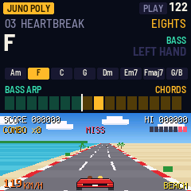
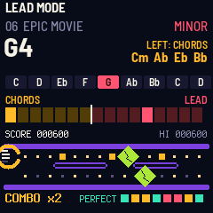
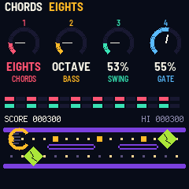
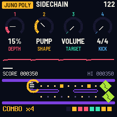

# CHORDMAN

A chord performance synth for the M-VAVE FM-1 by **swtdr34mz**. The keyboard is split: chords in a groove on the
right and a bass arp on the left, or a lead locked to the scale over the chords. Seven sounds after classic synths,
twenty chord sets by mood, a sidechain that makes room for the kick, MIDI clock in over USB, and CHORD MAN, an arcade
drive under every screen that rewards playing in time. Built on [fm1-base](https://github.com/charlesvestal/fm1-base)
and [felucca-bsp](https://github.com/hugelton/felucca-bsp).

 
 

Try it in the browser: <https://swtdr34mz-afk.github.io/CHORDMAN/emu/>

## The split

The keyboard has two halves, each with its own sound: **LEFT**, the lower twelve keys (F3 to E4), and **RIGHT**, the
upper fifteen (F4 to G5). SEL switches between two modes.

| | LEFT | RIGHT |
| --- | --- | --- |
| **CHORD mode** | the bass, only while you hold a key (or with HOLD): the white keys are the set's scale, a black key the same note an octave up. ARP on: a bass arp runs on the note; off: the note is held | the set's eight chords, one per white key (the ninth plays the first again). Each black key plays the chord on its left with more colour (a 7th, a 9th, a sus) |
| **LEAD mode** | the chords: the first seven on the white keys, coloured on the black keys. ARP decides how the left part plays them: as chords in the groove, or as a bass arp on their root | the lead: the white keys are the set's scale from its tonic, a black key the note a semitone up (a blue note) |

ARP switches the left part's job: in CHORD mode a bass arp or a held root; in LEAD mode chords or a bass arp (the
left sound follows: a pad for chords, a bass for the arp). REC is **HOLD**: a chord (and in CHORD mode the bass) stays when you let go of its key.

## The sounds

PRESETS changes the sound of the part in focus: the right part, or the left one while you hold a left key or are on
its SOUND or ENV page.

| Sound | After | How |
| --- | --- | --- |
| JUNO POLY, JUNO POLY II | a Juno-106's poly | one DCO (saw, pulse, sub), a soft four-pole filter, the BBD chorus I or II |
| JUNO PAD, JUNO PAD WIDE | a Juno-106's pad | PWM pulse and saw, slow envelopes, chorus II or I+II |
| OB BRASS, OB BRASS STAB | an Oberheim's brass | two saws a few cents apart into a two-pole filter that swells open |
| DX E.PIANO, DX E.PIANO II | a DX7's electric piano | six-operator FM, algorithm 5: the tine and the body |
| DX BELL, DX GLASS BELL | a DX7's bells | the same algorithm, bell ratios, long decays |
| MOOG BASS, MOOG SUB BASS | a Minimoog Model D's bass | three oscillators into the driven ladder, mono, glide |
| MOOG LEAD, MOOG LEAD SQUARE | a Minimoog Model D's lead | detuned saws or a square, the ladder, glide, delayed vibrato |

The filters run at twice the sample rate. Each oscillator drifts a little, as analog ones do.

## The pages

Every page shows its four knobs side by side, each in its own colour (1 red, 2 yellow, 3 mint, 4 blue, the same on
every page), with the game running underneath.

| Button | Page | K1 | K2 | K3 | K4 |
| --- | --- | --- | --- | --- | --- |
| HOME | play (the knobs are the right sound's) | TONE | MOTION | CHAR | SPACE |
| EDIT | SOUND: the right part, again the left, again HOME | TONE (the filter, or the FM's brightness) | MOTION (how far the envelope opens it) | CHAR: the chorus (Juno), the spread (OB), the drive (Moog), the shine (DX) | SPACE (the reverb, the delay past the middle) |
| ENV | the envelope: right, left, HOME | ATTACK | DECAY | SUSTAIN | RELEASE |
| LFO | LFO, in time with the clock: right, left, HOME | RATE: 4 BARS .. 1/32 | DEPTH | WAVE: SINE, TRIANGLE, SAW, REV SAW, SQUARE, S + H | TARGET: FILTER, PITCH, AMP, PWM |
| SEQ | GROOVE | CHORDS: FULL, QUARTER, EIGHTS, OFFBEAT, PUMP, SYNCO, HALF, ARP UP, ARP DOWN, ARP UP/DN, ARP RANDOM, CASCADE, TRANCE | BASS: ROOT, OCTAVE, OFFBEAT, ROLLING, ROOT-5TH, DISCO, HALF | SWING | GATE |
| FX | SIDECHAIN | DEPTH | SHAPE: SOFT, PUMP, HARD, GATE | TARGET: VOLUME, FILTER, BOTH | KICK: 4/4, HALF, 2 + 4, TRAP |
| GLO | GLOBAL | TEMPO | KEY | SYNC: AUTO, INT, EXT | USB HOST |

The other controls:

- **ALGORITHM** picks the chord set. With OCT- or OCT+ held, it sets the key.
- **SELECT** steps through the chord grooves.
- **PLAY** starts the transport, which sends MIDI clock.
- **SAVE** keeps everything.
- **HOME** held a second brings both sounds back as designed.
- **OCT- / OCT+** set the right part's octave. Both at once reset the octave and the key.

## The chord sets

Twenty moods, eight chords each: the first four are the progression, the next four its bridge and turnaround.

HAPPY · SUNSHINE · HEARTBREAK · MELANCHOLY · DRAMATIC · EPIC MOVIE · HERO · WONDER · 80s NOSTALGIA · FIFTIES · DREAM ·
LOFI · NEO SOUL · GOSPEL · DARK · MYSTERY · FUNK · HOUSE · TRANCE · BLUES

Five more are secret: the game unlocks them.

Each chord is voiced close to the one before it, so progressions move by steps, not jumps.

## The drive

Under every screen, your convertible cruises toward the horizon in the spirit of the 80s arcade racers. Everything is
drawn in the firmware. The road's stripes pass in time with the groove, and the scenery changes every 16 bars: BEACH,
CITY, SUNSET, NIGHT.

- **Timing:** every key you play is judged against the grid: PERFECT, GOOD or a miss.
- **Combo and speed:** hits build the combo and the speed, and close in on the rival car ahead. Passing it is worth
  300 points. A miss breaks the combo, and the rival pulls away.
- **TURBO:** a combo of 32 starts TURBO for eight bars, with double points.
- **Unlocks:** points add up over all your sessions and unlock the secret sets at 3,000, 10,000, 25,000, 50,000 and
  100,000. The best session is the high score.

## Sync

CHORDMAN follows MIDI clock with START, STOP and CONTINUE over USB. Set it with GLOBAL > SYNC: AUTO follows a clock
when one comes, INT ignores it, EXT waits for one. The sidechain's kick pattern runs in time with whatever clock leads.
Notes on channel 1 play the right part; other channels are ignored, so a drum machine's notes on 10 stay out.

**Two FM-1s:** set GLOBAL > USB HOST to ON and connect the other FM-1 with a USB-C to USB-C cable or an OTG adapter.
That FM-1 can run [SIX MACHINES](https://github.com/swtdr34mz-afk/SIX_MACHINES), for example, which sends clock, START
and STOP. The header shows LINK and the tempo heard. The port gives no power, so the other FM-1 runs on its own
battery. USB HOST is never saved: every power-on starts as a normal USB device again.

## Build

    git clone --recursive https://github.com/swtdr34mz-afk/CHORDMAN
    python3 fm1-base/tools/build.py . --host
    build/host/chordman_host tests/basic.txt build/host
    build/host/chordman_host tests/sync.txt build/host

GitHub Actions builds the firmware. A tag `v*` makes a release with the `.fwsc`.

## Licence

MPL-2.0. See [CREDITS.md](CREDITS.md).
