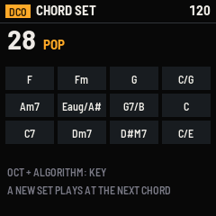
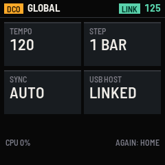

# CHORDMAN

A chord performance synth for the M-VAVE FM-1 by **swtdr34mz**. Four analog-style engines, the Roland J-6's 100 chord
sets on the lower twelve keys, a melody on the upper fifteen that keeps to the chord's scale, the J-6's grooves, a
chord sequencer, and MIDI clock and transport in over USB. Built on [fm1-base](https://github.com/charlesvestal/fm1-base)
and [felucca-bsp](https://github.com/hugelton/felucca-bsp).

Minimal by design: three encoders choose the sound, the chords and the groove; four knobs shape the sound; every page is
one level deep, and HOME is always one press away.

 
 

Try it in the browser: <https://swtdr34mz-afk.github.io/CHORDMAN/emu/>

## The four engines

Each engine is its own analog-style voice, eight sounds each (32 in all), eight voices. Their names say how they are
built; in brackets, the synth each one leans on.

| Engine | Built from | CHAR (K3 at HOME) | EDIT page |
| --- | --- | --- | --- |
| **DCO** (Juno-106) | one oscillator: saw, pulse with PWM, a square sub, noise; a soft four-pole low-pass | the BBD chorus: OFF, I, II, I+II | PWM, SUB, NOISE, RESO |
| **VCO** (Prophet-6) | two oscillators whose shape runs triangle, saw, square, narrow pulse; poly mod; a four-pole low-pass | SHAPE | DETUNE, OSC 2 (unison, +4th, +5th, octave up, down), POLYMOD, RESO |
| **SVF** (Oberheim) | two detuned saws (the second turning into a pulse) driven into a two-pole state-variable filter | MODE: low-pass, notch, high-pass, and between | DETUNE, PULSE, DRIVE, RESO |
| **LADDER** (Moog One) | two saws spread and a square sub, driven into a four-pole ladder; glide | DRIVE | DETUNE, SUB, GLIDE, RESO |

At HOME the four knobs are the same on every engine: **TONE** (the cutoff), **MOTION** (how far the envelope opens
it), **CHAR** (the engine's own), **SPACE** (the reverb, and the delay joining past the middle).

## The panel

| Control | What it does |
| --- | --- |
| PRESETS | the sound (32: DCO 1-8, VCO 9-16, SVF 17-24, LADDER 25-32) |
| ALGORITHM | the chord set, 1-100 (fast turns jump by five) |
| OCT- or OCT+ held + ALGORITHM | the key, -12 .. +12 semitones |
| SELECT | the groove (and it switches the groove on) |
| K1-K4 | at HOME: TONE, MOTION, CHAR, SPACE; on a page: that page's four |
| FX | VOICING (J-6, OPEN, WIDE, SMOOTH), STRUM, SWING, DELAY (OFF, 1/8, 3/16, 1/4, 3/8) |
| ENV | ATTACK, DECAY, SUSTAIN, RELEASE (the amp and the filter, as on a Juno) |
| LFO | RATE, DEPTH, TARGET (PITCH, FILTER, SHAPE, AMP), DELAY (its fade-in) |
| EDIT | the engine's own four (above) |
| GLO | TEMPO, STEP (the sequencer's step: 1/4, 1/2, 1 BAR), SYNC (AUTO, INT, EXT), USB HOST (OFF, ON), and the CPU load |
| a page button again | back to HOME |
| SEL | chord mode on and off (off: the 27 keys play notes) |
| HOME | the play screen; held a second: the sound back to its preset |
| SAVE | keeps everything over a power cycle (lit while something is not saved) |
| ARP | HOLD: a chord stays when its key is let go |
| SEQ | the groove on and off |
| PLAY | the chord sequencer from its first step, and stop |
| REC | recording; held a second: the sequence cleared |
| OCT- / OCT+ | the octave; both at once: octave and key back to 0 |

## The keys

In chord mode the **lower twelve keys** (F3 to E4) play the chord set: each key plays the chord of its pitch class,
as on the J-6 (the C key plays the set's C chord, wherever it lies). They glow; the chord sounding is lit. The **upper
fifteen keys** (F4 to G5) play a melody an octave above, through the same engine: a note outside the chord's scale
moves to the nearest one in it, so nothing clashes. The melody keys of the chord's notes glow.

**VOICING** (FX): **J-6** as the J-6 voices it; **OPEN** the second note an octave up; **WIDE** the bass an octave
down; **SMOOTH** each chord's notes kept close to the last one's, so progressions glide instead of jumping.
**STRUM** spreads a chord's notes up to 45 ms apart.

## The chord sets

The 100 sets of the J-6's Chord Set List, twelve chords each, voiced as the J-6 voices them: Pop, Jazz, Blues,
traditional major and minor, stacks, utility sets (every major, minor, maj7, m7, maj9, m9 ... chord), Cinematic,
Synthwave, Trance, House, Techno, EDM, Gospel and R&B, Lo-fi, Funk, Neo Soul, Bossa Nova, Classical and Modern. Turning
ALGORITHM shows the set's twelve chords in keyboard order.

## The grooves

The J-6's nine phrase styles, twelve variations each. SELECT runs through all 108; SEQ switches the groove off and on.

| Style | What it plays |
| --- | --- |
| ARP 8TH, ARP 16TH | the chord's notes one by one: up, up and down, down, over one or two octaves; 1-6 straight, 7-12 triplets |
| BEAT | the whole chord again every 2/1, 1/1, 1/2, 1/4, 1/8, 1/16; 7-12 the triplets |
| RHYTHM, SYNCOPE | the J-6's 16th patterns (o___, _o__, o~o_ ...); SYNCOPE 7-12 run in threes against the beat |
| PIANO | bass and chord, simple patterns |
| STABS | offbeat and syncopated chord stabs |
| STRUM, FUNK STRUM | strummed chords, down and up, simple and in 16ths |

SWING (FX) delays the off 16ths, up to 75 %.

## The sequencer

Sixteen steps, each a chord (or a tie, or a rest), a quarter, half a bar or a bar long (GLOBAL > STEP).

- **Step recording:** stopped, press REC. Each chord key writes the next step; ARP writes a tie, SEL a rest. The
  sequence is as long as what you wrote. REC again ends it.
- **Live recording:** playing, press REC. A chord key writes the nearest step.
- **Clear:** hold REC a second.
- While it plays, a chord key you hold wins over the sequence, and the groove plays whatever chord sounds.

## Sync: MIDI clock and transport

CHORDMAN follows MIDI clock (24 a quarter) with START, STOP and CONTINUE over USB. GLOBAL > SYNC: **AUTO** follows a
clock when one comes (the header shows EXT and the tempo heard) and runs on its own tempo otherwise; **INT** ignores
it; **EXT** waits for it. Notes on channel 1 play the melody; other channels are ignored (a drum machine's notes on
channel 10 stay out). Playing on its own tempo, CHORDMAN sends clock with START and STOP to USB.

**Two FM-1s:** the FM-1 has a MIDI IN jack only, so two FM-1s talk over USB, and one has to be the USB host. Set
GLOBAL > USB HOST to ON on CHORDMAN and connect the other FM-1 (for example running
[SIX MACHINES](https://github.com/swtdr34mz-afk/SIX_MACHINES), which sends clock, START and STOP) with a USB-C to USB-C
cable or an OTG adapter. The header shows LINK while the clock comes in. The port gives no power: the other FM-1 runs
on its battery (or through a powered hub). USB HOST is never saved: every power-on is a normal USB device again, so a
computer, updates and backups always find the FM-1.

## Install

Releases: <https://github.com/swtdr34mz-afk/CHORDMAN/releases> (the `.fwsc`, installed like any fm1-base firmware).

## Build

    git clone --recursive https://github.com/swtdr34mz-afk/CHORDMAN
    python3 fm1-base/tools/build.py . --host        # the host simulator
    build/host/chordman_host tests/basic.txt build/host
    build/host/chordman_host tests/sync.txt build/host

The firmware itself is built on GitHub Actions (`.github/workflows/build.yml`), which fetches JieLi's toolchain. A tag
`v*` makes a release with the `.fwsc`.

`tools/` holds the scripts that read the chord sets out of the J-6 manual's table (`words.py`, `parse3.py`) and write
`dsp/chords.c` (`gen_chords.py`).

## Licence

MPL-2.0. See [CREDITS.md](CREDITS.md).
